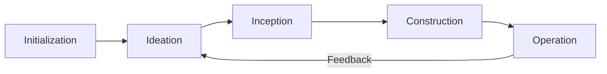
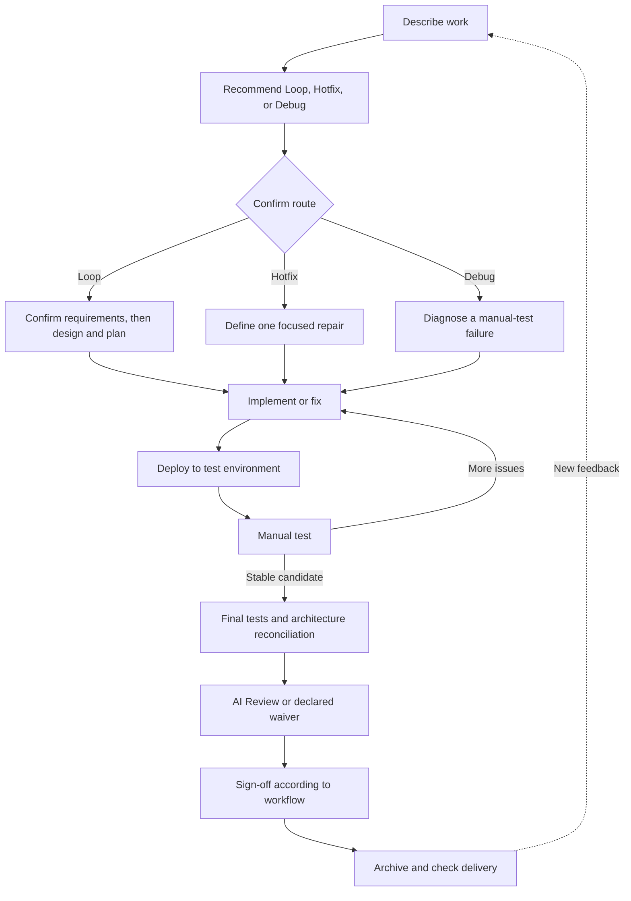
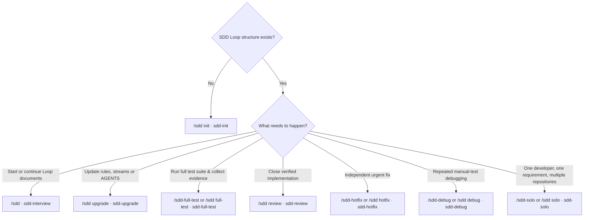

# sdd-loop

**From an idea to a reviewed delivery, with decisions kept in the repository.** sdd-loop gives AI agents and people a shared path through planning, implementation, testing, and approval.

  

<a href="README.md">English</a> · <a href="README_zh.md">简体中文</a>

## The AI-DLC lifecycle

[AWS AI-DLC](https://awslabs.github.io/aidlc-workflows/guide/04-phases-and-stages/) describes five phases and a feedback loop. The stages included in a particular run depend on its scope:



| Phase | Main question |
|---|---|
| **Initialization** | Is the workspace and its state ready? |
| **Ideation** | What is the intent, scope, and reason to proceed? |
| **Inception** | What requirements, design, work units, and delivery plan will guide the build? |
| **Construction** | Can the solution be built and tested in reviewable pieces? |
| **Operation** | Can it be deployed, observed, supported, and improved from feedback? |

AI-DLC checks artifact consistency and traceability at phase boundaries before downstream work proceeds. People approve the decisions that need judgment.

sdd-loop applies this intent-to-feedback path to repository work. It offers three routes, so a feature, urgent fix, and manual-testing session can each follow a fitting workflow.

## Choose a workflow

| Route | Use it for | Path |
|---|---|---|
| **Loop** | A feature or planned change | A 7-station interview leads through requirements, design, implementation, and verification. |
| **Hotfix** | A focused urgent repair | One independent repair document, followed by validation and acceptance. |
| **Debug** | Repeated deployment and manual testing | Diagnose, fix, deploy, and retest until the result is ready for closeout. |

Describe the task to pi's `/sdd` command or the `sdd-route` Skill on another host. It recommends a route with a reason; **you confirm the choice** before work starts. The project can choose the order of deployment, manual testing, verification, and review in its [workflow definition](workflows/loop/workflow.md).

### sdd-loop delivery flow



This shows the built-in order; a project's workflow definition controls the actual stage dependencies. A Loop keeps six documents: `requirements.md`, `architecture.md`, `specification.md`, `tasks.md`, `implementation.md`, and `verification.md`. AI Review examines the stable candidate; Human Review records the acceptance decision.

| Mechanism | Rule |
|---|---|
| Roles | Requester, Product, Architect, Implementer, Reviewer and Approver map to Git emails |
| Approve | Confirms the current stage and enters `awaiting-continue`; it does not advance `nextPhase` |
| Continue | Must come from a later user message and revalidates role and document fingerprint |
| Audit | Each worktree appends to its own `audit/*.jsonl` shard; a hash chain detects rewriting |
| Privacy | Tokens, passwords and private keys are redacted; local worktree paths and full AI output are not stored |
| Invalidation | Document changes invalidate approval; code or critical-document changes invalidate review and signing |

### Engineering quality extensions

All four are enabled by default. Every Loop records `PASS`, `FAIL` or a reasoned `N/A`:

| Extension | Use it for | PASS evidence |
|---|---|---|
| Testing | Every change with executable behavior | Acceptance mapping, commands, exit codes, results and uncovered areas |
| PBT | Parsers, business rules, state machines, authorization, idempotency, ordering, pagination and concurrency | Property, input domain, case count, seed and regression counterexamples |
| Security | Changes to input, identity, authorization, tenancy, secrets, dependencies or network boundaries | Trust boundaries, negative tests, checks and residual risk |
| Resiliency | External dependencies, retry, transactions, deployment or runtime behavior | Failure scenarios, timeout/retry/idempotency, rollback and observability evidence |

Without a PBT library use: `existing library → existing test framework + deterministic seeded generator → approved new dependency`. A missing library is not an `N/A` reason; `N/A` is valid only when no valuable invariant exists.

### Worktree isolation

- Split repos use one branch and worktree per `stream + Loop`.
- The main checkout is only for synchronization, integration and review.
- Cross-system/platform changes use their own platform worktree.
- A Loop already implementing in the main checkout may record a one-time exemption; the next Loop cannot inherit it.

### Architecture and review

- Loop-local `architecture.md` describes this round's design. `docs/architecture/` describes the system as it exists now.
- Reuse an existing architecture layout. Otherwise use `docs/architecture/overview.md` for one system or `docs/architecture/<stream>.md` for split repos. Diagrams use Mermaid or ASCII.
- After automated verification, update the Architecture Baseline from final code and list the code, configuration, data, API, deployment, test and documentation change surface.
- Before AI Review, pause for a human choice: stay with the current Agent's read-only subagent, or name another Agent and receive a handoff. No self-review or silent fallback. Valid verdicts: `READY_FOR_HUMAN_REVIEW`, `CHANGES_REQUIRED`, `NOT_REVIEWABLE_SAFELY`.

| Human choice | Current Agent action | Reviewer |
|---|---|---|
| Stay | Start a read-only subagent; only consolidate its result | Independent subagent |
| Switch | Ask which Agent, provide handoff, then wait | Named Agent's isolated read-only reviewer |
- `verification.md` contains `Automated Verification`, `Architecture Reconciliation & Change Surface`, `AI Code Review` and `Human Review Packet`.
- Any code or critical-document change invalidates the old review. A Loop closes only after a human records approver, time, reviewed version and fingerprint.

### Independent Hotfix channel

`/sdd-hotfix` (pi also accepts `/sdd hotfix`) is for a user-selected urgent fix. It runs beside the ordinary Loop, never changes `activeLoop`, and is not a switch for skipping ordinary Loop stages.

```text
Read-only launch card (scope + risks + reviewer) → one user confirmation → isolated implementation
→ Testing/PBT/Security/Resiliency → independent read-only AI Review
→ human signs the current fingerprint → archive document and audit together
```

Each Hotfix has one `hotfix-YYYYMMDD-NN.md`. Single-stream repositories use `docs/loops/hotfix/`; split repositories use `docs/loops/<stream>/hotfix/`. Closed Hotfixes move to the corresponding `docs/archive[/<stream>]/hotfix/`. Numbering is per stream and day, scanning both active and archived files. Testing must PASS; the other three extensions must PASS or provide a specific N/A reason. Architecture-impacting fixes must reconcile the long-lived Architecture Baseline.

### Manual-testing Debug channel

`/sdd-debug` (pi also accepts `/sdd debug`) supports repeated manual testing and repair in a test environment. It neither occupies nor advances the ordinary Loop, and it does not require an up-front scope card, Hotfix document, or Reviewer choice.

The channel requires `governanceVersion: 1` and a `roleApprover` mapping. `/sdd-debug` checks these before the first fix. For an older repository, use `/sdd upgrade`: the AGENTS clause-alignment action adds the Debug rules only after you approve the candidate, while a repository that still lacks governance is reported as “rules aligned, channel not enabled” until you also choose the governance upgrade action.

```text
Capture the Git/worktree baseline → user reports a manual-test failure → AI diagnoses and fixes → focused checks
→ AI or user deploys to the test environment → user tests again (repeat)
→ user says “start closeout” → final tests/build/smoke → update long-lived architecture from final code
→ backfill and archive a route: debug Hotfix → debug_closed
```

Debug does not repeatedly request scope approval when a necessary related change exceeds the ordinary Loop's predicted change surface. It pauses only for a new product-behavior decision, production operation, destructive data change, Secrets/permission/security-policy change, external cost, or shared-environment action that cannot be safely rolled back. Closeout must state `acceptanceMode: manual-test`, `reviewStatus: waived`, and `MANUAL_TEST_ACCEPTED_NO_INDEPENDENT_REVIEW`; manual testing must not be presented as `READY_FOR_HUMAN_REVIEW`. The user's “start closeout” authorizes both the retrospective record and closure, with no second confirmation.

### Full-Test Evidence Runner

`/sdd-full-test` (pi also accepts `/sdd full-test`) executes project test plugins and collects verifiable evidence bundles. It acts strictly as an evidence runner, never deciding verification verdicts, and produces bundles with `manifest.sha256`; record that manifest's SHA-256 outside the bundle to anchor later human and AI Review.

```text
Discover plugin manifest (tests/sdd/plugin.yaml or custom path) → validate sdd-full-test/v1
→ select profile or suites → preflight check & mutual exclusion locks
→ run suites & perform teardown verification on finally path (unverified cleanup forbids PASS)
→ build Evidence Bundle with manifest.sha256
→ propose verification.md facts & many-to-many extensionClaims
```

### Solo multi-repository delivery

`/sdd-solo` (pi also accepts `/sdd solo`) is for one developer delivering one requirement across several Git repositories without leaving the primary-repository conversation. The repository where the work starts is the primary repository and owns the only editable Requirements and cross-repository design. Participant repositories do not start an independent Loop for the same requirement.

```text
Ask once for scannable workspace roots → discover candidate repositories from code and dependency evidence
→ fetch each candidate's remote master and pin its commit → user confirms participants
→ inspect relevant code and clarify requirements rigorously
→ show one combined requirements + recommended mode confirmation
→ full: complete SDD and per-repository review → freeze the authority source
→ complete the checkbox release checklist → export, commit and verify every participant trace → aggregate review → machine closure receipt → final human approval
→ openspec-light: continuously generate Proposal / Spec / Tasks, implement and verify
→ complete the checkbox release checklist → export, commit and machine-check every participant trace → report results → archive only after user acceptance
```

The demand ID and title are confirmed once. `sdd-solo` derives the conversation title as `[SDD Solo][<demandId>] <title>` and one canonical branch for all participants as `feature/<yyMMdd>_<demandId>_<shortTitle>`. It records every repository's actual branch and any exception; an existing demand branch or uncommitted demand work is preserved instead of being forcibly renamed or switched. Conversation renaming is automatic when the host supports it and advisory otherwise, so it is not a governance gate.

After requirements are clear, the Skill recommends `full` or `openspec-light` from substantive complexity, preferring light by default. Repository count, estimated lines changed, and merely touching a cross-repository call are not full-mode criteria. A simple requirement with clear boundaries, per-repository tasks, credible verification and rollback remains light even across several repositories or with a backward-compatible contract adjustment. Full is reserved for breaking contracts or coordinated cutovers, complex migrations, material authorization/security/funds/compliance behavior changes, complex staged releases, architecture alternatives requiring separate approval, irreversible or high-blast-radius operations, or an explicit full-governance mandate. Unknowns trigger more investigation and questions rather than automatically becoming full. A user may promote a light recommendation to full; remaining full triggers must instead be removed by narrowing scope or adding credible compatibility, verification and rollback controls before light can be selected. Once confirmed, `openspec-light` does not pause again between Proposal, Spec, Tasks, or Apply; it reports after implementation, necessary verification and lightweight trace export, then waits for user acceptance before Archive.

In `full`, each per-repository unit lives under the primary demand and records that repository's real baseline, tasks, implementation, verification, review and readiness receipt. Light mode retains only the OpenSpec, implementation and verification trace required for independent follow-up. Both modes maintain one authoritative `release-checklist.md` in the primary repository, using concise checkboxes for release repositories and order, SQL, project configuration, FilerUI configuration, post-release verification and rollback; non-applicable categories require a reason. `ready` means the deployment plan is complete, not that deployment has happened, so unexecuted steps stay `[ ]` and can be checked later. The machine fingerprint ignores checkbox-only changes, while any change to the plan invalidates the old receipt. Only the participant's own evidence and relevant dependencies are exported; primary `status.md`, primary audit events, other repositories' evidence, the release checklist and long-lived Architecture Baselines are not copied. Before a full approval or a light result report, `sdd-loop solo check --write-receipt` must read each trace package from its recorded participant commit, verify every file and hash, and write the primary closure receipt. A governance-v2 full Loop creates this receipt before `candidate`; the candidate fingerprints the participant manifest and receipt, so later drift invalidates final tests, review and sign-off. Governance v1 keeps its existing stage events and rechecks the receipt at `loop_closed`; v2 rechecks it at `workflow close`. Missing or drifted participant evidence is a hard stop; late backfill after approval is not a valid close. Branches or worktrees may be used internally for isolation, but users keep all interaction in the primary conversation. `sdd-solo` is the multi-repository workflow; `demandId` is the independent same-repository concurrency model, and `stream` continues to mean a subsystem inside one Git repository.

## AGENTS.md handling

- Without an existing AGENTS.md, sdd-init selects the applicable single/split-project rules and writes the final structured file directly.
- With an existing AGENTS.md, sdd-init or sdd-upgrade writes `AGENTS.candidate.md` and an itemized report under `/tmp`; it never silently overwrites the repository file.
- In an initialized project, `/sdd upgrade` clause alignment discovers the resident Debug clauses through `AGENTS.md.CHANGELOG.md`; after the user approves the candidates, it adds them to the project's `AGENTS.md` without replacing project-specific rules.
- Deletion, movement and merging require item-by-item approval. Model, permission, MCP and host configuration are out of scope.

Classifications: `KEEP_SDD_CANONICAL`, `KEEP_PROJECT_SPECIFIC`, `DUPLICATED`, `STALE`, `MODEL_OR_HOST_SPECIFIC`, `BELONGS_IN_AGENT_CONFIG`, `CANONICAL_ELSEWHERE`, `UNCLEAR`.

Audit verdicts: `RECOMMEND_ADOPTION`, `NEEDS_REVISION`, `KEEP_CURRENT`, `NOT_TESTABLE_SAFELY`.

## Installation

Requires Node ≥ 20.

**Full: nine Skills + `capabilities` / `check` / `workflow` / `provenance` / `solo check` / `guide` CLI**

```bash
git clone https://github.com/Roger0808/sdd-loop.git && cd sdd-loop
npm install
npm link
sdd-loop init -g
```

If the CLI is already installed, install only the Skills with `npx skills@latest add Roger0808/sdd-loop -g`. Restart the agent or open a new session after installation.

Check that the current host has the workflow resources:

```bash
sdd-loop capabilities --require governance@2 --host agents
```

Choose `--host` from `claude`, `agents`, `openclaw`, `hermes`, or `pi`:

| Target | Installation |
|---|---|
| Packaged Skills | [sdd-init](skills/sdd-init), [sdd-interview](skills/sdd-interview), [sdd-route](skills/sdd-route), [sdd-upgrade](skills/sdd-upgrade), [sdd-review](skills/sdd-review), [sdd-hotfix](skills/sdd-hotfix), [sdd-debug](skills/sdd-debug), [sdd-full-test](skills/sdd-full-test), [sdd-solo](skills/sdd-solo) |
| Claude Code | `~/.claude/skills/` |
| Agent Skills | `~/.agents/skills/` for Codex, Gemini CLI, GitHub Copilot, Cursor, Windsurf, OpenCode, Kimi Code, Antigravity, Factory Droid, and Roo Code |
| OpenClaw | Shared location by default; `OPENCLAW_STATE_DIR` selects a custom state directory |
| Hermes Agent | Skills configuration |
| pi | Package registration |

Limit `init -g` with `--claude`, `--agents`, `--openclaw`, `--hermes`, or `--pi`; `--show` previews the plan. Existing files are never overwritten.

### First use

In a new repository, ask the agent for `/sdd init` (`sdd-init`), then describe the work with `/sdd`. To inspect a route before confirming it:

```bash
sdd-loop workflow recommend --request-file /tmp/request.txt --repo .
sdd-loop workflow show --route loop --repo .
```

Once you confirm a route, the agent starts and tracks the work. Project setup for configurable routes is described in [`sdd-route`](skills/sdd-route/SKILL.md).

## Skills and commands

| Ask for | Skill | Purpose |
|---|---|---|
| `/sdd init` | [`sdd-init`](skills/sdd-init) | Set up repository rules and status. |
| `/sdd` | [`sdd-interview`](skills/sdd-interview), [`sdd-route`](skills/sdd-route) | Start or continue work; recommend a route and wait for confirmation. |
| `/sdd upgrade` | [`sdd-upgrade`](skills/sdd-upgrade) | Align rules, split streams, or switch a completed v1 stream to v2 for future work. |
| `/sdd review` | [`sdd-review`](skills/sdd-review) | Reconcile the Architecture Baseline, prepare the AI Review and Human Review packet. |
| `/sdd-hotfix` | [`sdd-hotfix`](skills/sdd-hotfix) | Run an independent urgent fix; pi also accepts `/sdd hotfix`. |
| `/sdd-debug` | [`sdd-debug`](skills/sdd-debug) | Repeat manual testing and repairs; pi also accepts `/sdd debug`. |
| `/sdd-full-test` | [`sdd-full-test`](skills/sdd-full-test) | Collect a verifiable test evidence bundle; pi also accepts `/sdd full-test`. |

The CLI supplies six user commands:

| Command | Purpose |
|---|---|
| `sdd-loop check --repo <dir> [--stream <name> \| --demand <id>]` | Read-only comparison of status declarations and repository facts; exit `0` clean, `1` inconsistent, `2` unreadable. |
| `sdd-loop guide --type specification.entity-table` | Clause guidance, existing ID families, and a repository example before writing. |
| `sdd-loop capabilities --require governance@2 --host agents` | Verify CLI, rules, and installed host Skills. |
| `sdd-loop workflow` (`recommend`, `show`, `start`, `record`, `close`) | Recommend a route, inspect its graph, and track confirmed work. |
| `sdd-loop provenance check --base <base> --head <head>` | Check whether delivered code changes have matching review evidence. |
| `sdd-loop init -g` | Install Skills and host integration; it does not initialize a project. |

## Make it fit your project

Start from the [Loop](workflows/loop/workflow.md), [Hotfix](workflows/hotfix/workflow.md), or [Debug](workflows/debug/workflow.md) workflow. A project can replace a route at `docs/sdd/workflows/<route>/workflow.md`; a stream can provide its own definition at `docs/sdd/workflows/<stream>/<route>/workflow.md`; a demand can provide one at `docs/sdd/workflows/demands/<demandId>/<route>/workflow.md`. Each definition sets stage dependencies, Review policy, and who signs. A route already in progress keeps the definition chosen at its start.

`AGENTS.md` holds project rules. For an existing repository, `/sdd upgrade` prepares proposed rule changes for human review. A v1-to-v2 switch applies only after the stream's v1 work is closed; it starts the next work under v2 without rewriting old audits. Project conventions and installed tools are updated separately. Full governance contracts live in the [Skills](skills/sdd-init) and [maintainer architecture](CLAUDE.md).

To update a full installation:

```bash
git pull --ff-only
npm install
npm link
sdd-loop init -g
```

**Skills-only installation**

```bash
npx skills@latest update -g
```

| Update | Effect |
|---|---|
| `git pull` | Updates the CLI and symlinked Skill contents |
| `sdd-loop init -g` | Adds newly packaged Skills or host configuration |
| `npx skills@latest update -g` | Updates installations managed by `npx skills` |
| `sdd-upgrade` | Updates SDD/AGENTS rules inside a project; not the installed package |

Restart the host or open a new session after installation.

```bash
sdd-loop capabilities --require governance@1 --host agents
sdd-loop capabilities --require governance@2 --host agents
sdd-loop capabilities --require hotfix@1 --host agents
sdd-loop capabilities --require debug@1 --host agents
sdd-loop capabilities --require full-test@1 --host agents
sdd-loop capabilities --require solo@1 --host agents
```

Run this before working in a governance-enabled repository. Set `--host` to `claude`, `agents`, `openclaw`, `hermes`, or `pi`; Codex, Kimi Code, and other shared Agent Skills hosts use `agents`. A missing command or non-zero exit means the CLI/rule resources are incomplete or Skills are not installed for that host. Project rules never auto-update tools.

## Commands

| CLI | Purpose |
|---|---|
| `sdd-loop capabilities --require governance@1 --host <host>` | Fail-closed check that the CLI, governance resources and host Skill installation support protocol 1 |
| `sdd-loop capabilities --require governance@2 --host <host>` | Fail-closed check that configurable workflow governance and host Skill installation support protocol 2 |
| `sdd-loop capabilities --require hotfix@1 --host <host>` | Check the Hotfix protocol, governance dependency and host discovery of `sdd-hotfix` |
| `sdd-loop capabilities --require debug@1 --host <host>` | Check the Debug retrospective-closeout protocol, governance dependency and host discovery of `sdd-debug` |
| `sdd-loop capabilities --require full-test@1 --host <host>` | Check the Full-Test protocol resources and host discovery of `sdd-full-test` |
| `sdd-loop capabilities --require solo@1 --host <host>` | Check the multi-repository Solo protocol, resources and host discovery of `sdd-solo`; a confirmed `full` delivery separately requires the demand's declared governance version |
| `sdd-loop check` | Reconcile status declarations with repository facts |
| `sdd-loop solo check --manifest <path> --participant <id=path> ... --write-receipt` | Verify committed participant trace packages and write the primary closure receipt; repository paths are runtime-only bindings |
| `sdd-loop guide --type <doc.clause>` | Show clause guidance and existing ID families |

### Eight workflow commands



| pi command | Skill name / slash alias | Use it when | Result |
|---|---|---|---|
| `/sdd init` | `sdd-init` / `/sdd-init` | A repository has no SDD Loop structure | Creates the repository rules and initial status; does not write product content |
| `/sdd` | `sdd-interview` / `/sdd-interview` | Starting a product or a new Loop | Interviews and produces `requirements.md`, `architecture.md`, `specification.md` and `tasks.md`; each Requirements round can use the standard flow or an optional deep interview that the user can stop at any time |
| `/sdd upgrade` | `sdd-upgrade` / `/sdd-upgrade` | An initialized repository needs current gates, governance roles, split-stream migration or AGENTS audit | Upgrades existing SDD conventions without inventing history or silently replacing project rules |
| `/sdd full-test`, `/sdd-full-test` | `sdd-full-test` / `/sdd-full-test` | Project test suites need execution to collect a verifiable evidence bundle | Executes tests, builds evidence bundle with an externally anchorable SHA-256 manifest, proposes `verification.md` facts and extension claims |
| `/sdd review` | `sdd-review` / `/sdd-review` | Implementation and automated verification are complete | Reconciles architecture, records change surface, runs AI review and prepares human review |
| `/sdd hotfix`, `/sdd-hotfix` | `sdd-hotfix` / `/sdd-hotfix` | The user chooses an urgent fix that must not advance the ordinary Loop | One Hotfix document, isolated audit, verification, AI Review and human sign-off |
| `/sdd debug`, `/sdd-debug` | `sdd-debug` / `/sdd-debug` | Manual testing, repair and test-environment deployment repeat until the user starts closeout | No stage documents or independent Review while debugging; closeout backfills a Debug Hotfix, updates long-lived architecture, and records manual acceptance plus the Review waiver |
| `/sdd solo`, `/sdd-solo` | `sdd-solo` / `/sdd-solo` | One developer delivers the same requirement across multiple Git repositories from one primary conversation | Clarifies requirements and recommends `full` or `openspec-light`; both modes must export, commit and machine-check every participant trace before approval or result reporting |

pi uses the first column; other hosts invoke the Skill name or slash alias.

### Status reconciliation

```bash
sdd-loop check
sdd-loop check --repo <dir>
sdd-loop check --stream <name>
sdd-loop check --demand <demandId>
sdd-loop check --json
```

| Exit | Meaning |
|---|---|
| `0` | clean |
| `1` | declarations contradict repository facts |
| `2` | evidence is unreadable; no verdict |

Demand units live under `docs/loops/demands/<demandId>/`, with `demandId` and its bound Git `branch` declared in that unit's `status.md`. `check` auto-selects the unique demand bound to the current branch; `--demand` selects another unit explicitly and reports the branch mismatch as an advisory. `--demand` and `--stream` are mutually exclusive. A repository with only the legacy root `docs/loops/status.md` keeps the previous behavior and output unchanged; once demand directories exist without a matching branch or legacy fallback, selection must be explicit.

Repositories with `governanceVersion: 1` also validate approval/Continue, role identity, the audit hash chain, fingerprints, all four engineering extensions and the human close gate. In split-stream repositories, `review_completed` records the Loop's reviewed `deliveryScope`; C10 later fingerprints only that scope, so delivery in a sibling stream does not invalidate the closed Loop. If its own protected scope later changes legitimately, an Approver can append `closure_drift_accepted` with the reviewed reason and evidence; legacy closed streams establish their scope during this first acceptance, and established scopes cannot be narrowed or replaced. Any later change inside that scope fails closed again. Older CLIs remain red rather than silently accepting the new event. Loop control and archive directories are excluded from split-stream delivery fingerprints. When Hotfix files exist, H1–H5 are appended; `route: debug` uses those checks for manual acceptance, final evidence and the Review waiver, while rejecting standard-Hotfix Review/sign-off events. Without Hotfix files, existing text, JSON, pi details and exit codes stay unchanged.

### Clause guide

```bash
sdd-loop guide
sdd-loop guide --type specification.entity-table
```

It returns the required fields, existing ID families and a repository example before a clause is written. Unknown pi `/sdd` subcommands return usage.

## Repository layout

```text
your-project/
├── AGENTS.md
├── CLAUDE.md
└── docs/
    ├── architecture/
    │   └── overview.md or <stream>.md
    ├── loops/
    │   ├── status.md                       # legacy single-stream unit
    │   ├── [<stream>/]                    # optional same-repository subsystem
    │   │   ├── status.md
    │   │   ├── hotfix/
    │   │   │   ├── hotfix-YYYYMMDD-NN.md
    │   │   │   └── audit/hotfix-YYYYMMDD-NN/<writer-id>.jsonl
    │   │   └── loop-N/...
    │   └── demands/
    │       └── <demandId>/
    │           ├── status.md               # demandId + bound branch
    │           └── loop-N/
    │               ├── audit/<writer-id>.jsonl
    │               ├── requirements.md
    │               ├── architecture.md
    │               ├── specification.md
    │               ├── tasks.md
    │               ├── implementation.md
    │               └── verification.md
    ├── sdd/extensions/        # optional project extensions; *.opt-in.md controls enablement
    └── archive/
        ├── [<stream>/]hotfix/          # closed Hotfix document and audit/
        └── demands/<demandId>/loop-N/ # closed demand Loop
```

`sdd-loop check` discovers legacy single-stream, split-stream and demand-unit layouts automatically. Custom paths use `--status-file` and `--archive-dir`.

## License

MIT — [LICENSE](LICENSE).
