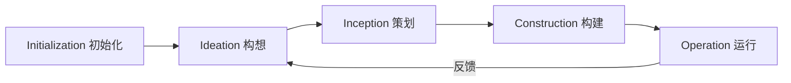
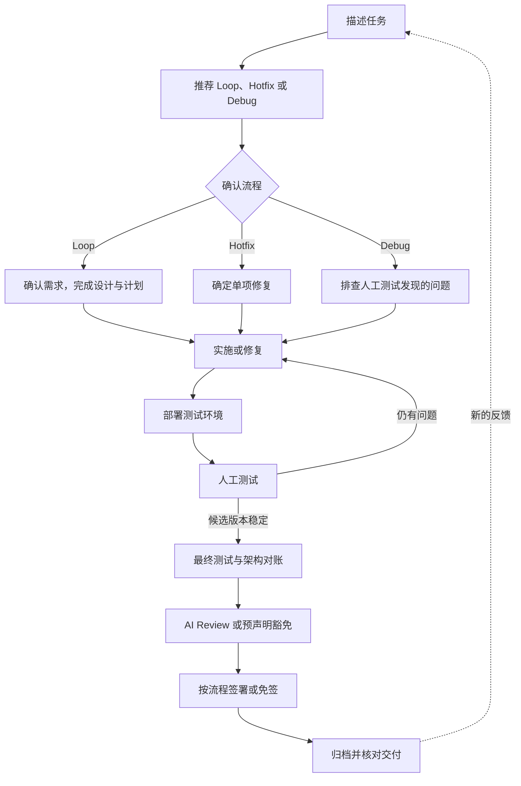
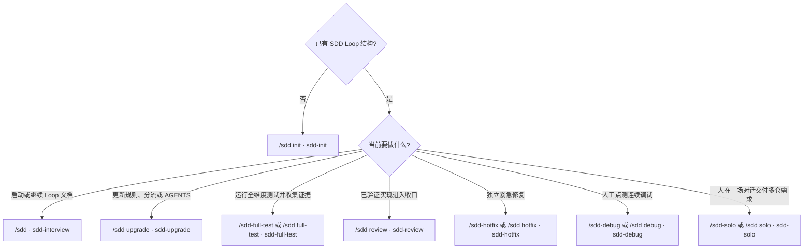

# sdd-loop

**从想法到审查通过的交付，把决定留在仓库里。** sdd-loop 为人和 AI Agent 提供共同的规划、实施、测试与验收路径。

  

<a href="README.md">English</a> · <a href="README_zh.md">简体中文</a>

## AI-DLC 的流程

[AWS AI-DLC](https://awslabs.github.io/aidlc-workflows/guide/04-phases-and-stages/) 将开发生命周期分为五个阶段，并让运行反馈进入下一轮；每次实际执行的阶段由工作范围决定：



| 阶段 | 要回答的问题 |
|---|---|
| **Initialization 初始化** | 工作区和流程状态准备好了吗？ |
| **Ideation 构想** | 要解决什么问题，范围和目标是什么，是否值得继续？ |
| **Inception 策划** | 需求、设计、工作拆分与交付计划是什么？ |
| **Construction 构建** | 能否分步实现、测试并审查？ |
| **Operation 运行** | 能否部署、观测、维护，并从反馈中改进？ |

进入下一阶段前，AI-DLC 会核查产物的一致性和可追溯关系；需要判断的决定仍由人确认。

sdd-loop 将这条“意图到反馈”的主线用于仓库交付，并提供三种流程，让功能开发、紧急修复和连续手测分别走适合的路径。

## 选择工作流程

| 流程 | 适用场景 | 路径 |
|---|---|---|
| **Loop** | 新功能或计划内改动 | 七站访谈引导需求、设计、实施与验证。 |
| **Hotfix** | 范围明确的紧急修复 | 一份独立修复文档，随后验证和验收。 |
| **Debug** | 反复部署与人工测试 | 排查、修复、部署和复测，直到可以收口。 |

向 pi 的 `/sdd` 命令或其他宿主的 `sdd-route` Skill 描述任务。它会说明推荐哪条流程及理由；**你确认后才启动**。项目可在 [workflow 定义](workflows/loop/workflow.md) 中安排部署、人工测试、验证和审查的顺序。

### sdd-loop 交付流程



图中是内置流程的顺序，项目的 workflow 定义决定实际阶段依赖。一轮 Loop 保留六份文档：`requirements.md`、`architecture.md`、`specification.md`、`tasks.md`、`implementation.md`、`verification.md`。AI Review 审查稳定候选，Human Review 记录验收决定。

| 机制 | 规则 |
|---|---|
| 角色 | Requester、Product、Architect、Implementer、Reviewer、Approver 映射到 Git 邮箱 |
| Approve | 确认当前阶段并进入 `awaiting-continue`，不推进 `nextPhase` |
| Continue | 必须来自后续用户消息；重新校验角色和文档指纹 |
| 审计 | 每个 worktree 向自己的 `audit/*.jsonl` 分片追加事件，哈希链防篡改 |
| 隐私 | Token、密码和私钥脱敏；不记录本机 worktree 绝对路径或完整 AI 输出 |
| 失效 | 审批后文档变化使审批失效；Review 后代码或关键文档变化使签署失效 |

### 工程质量扩展

四项默认启用；每轮都必须写 `PASS`、`FAIL` 或有理由的 `N/A`：

| 扩展 | 何时使用 | PASS 证据 |
|---|---|---|
| Testing | 所有存在可执行行为的改动 | 验收条件映射、命令、退出码、结果和未覆盖范围 |
| PBT | Parser、业务规则、状态机、权限、幂等、排序、分页、并发 | Property、输入域、case 数、seed 和回归反例 |
| Security | 输入、身份、权限、租户、Secrets、依赖或网络边界变化 | 信任边界、负向测试、检查结果和剩余风险 |
| Resiliency | 外部依赖、重试、事务、部署或运行时变化 | 故障场景、超时/重试/幂等、回滚和观测证据 |

没有 PBT 库时：`现有库 → 现有测试框架 + 确定性 seed 生成器 → 获批后新增依赖`。没有库本身不是 `N/A` 理由；只有不存在有价值的不变量时才可写明理由后跳过。

### Worktree 隔离

- 分流项目每个 `stream + Loop` 使用独立分支和 worktree。
- 主工作区只用于同步、集成和审查。
- 跨系统或平台级改动使用独立的 platform worktree。
- 已在主工作区实施的存量 Loop 可记录一次性豁免；下一个 Loop 不得继承。

### 架构与审查

- 本轮 `architecture.md` 描述本轮方案；`docs/architecture/` 描述系统当前事实。
- 优先沿用已有架构目录；没有时，单系统用 `docs/architecture/overview.md`，分流项目用 `docs/architecture/<stream>.md`。架构图使用 Mermaid 或 ASCII。
- 自动化验证后，按最终代码更新 Architecture Baseline，并列出代码、配置、数据、接口、部署、测试和文档改动面。
- AI Review 前停下由人类选择审查路径：留在当前 Agent 时由只读 subagent 审；换 Agent 时确认对象、生成 handoff 并等待结果。缺独立 reviewer 不自审。结论只能是 `READY_FOR_HUMAN_REVIEW`、`CHANGES_REQUIRED` 或 `NOT_REVIEWABLE_SAFELY`。

| 人类选择 | 当前 Agent 的动作 | 审查者 |
|---|---|---|
| 留在当前 Agent | 启动只读 subagent；本体仅整理结果 | 独立 subagent |
| 换一个 Agent | 追问具体对象，交付 handoff 后等待 | 指定 Agent 的独立只读 reviewer |
- `verification.md` 固定包含 `Automated Verification`、`Architecture Reconciliation & Change Surface`、`AI Code Review` 和 `Human Review Packet`。
- 代码或关键文档变化会使旧审查失效。只有人工记录确认人、时间、审查版本和指纹后才能关闭 Loop。

### Hotfix 独立通道

`/sdd-hotfix`（pi 也支持 `/sdd hotfix`）用于用户明确选择的紧急修复。它与普通 Loop 并行，不修改 `activeLoop`，也不把 Hotfix 当作普通 Loop 的跳阶段开关。

```text
只读启动卡（范围 + 风险 + reviewer） → 用户一次确认 → 隔离实施
→ Testing/PBT/Security/Resiliency → 独立只读 AI Review
→ 人工签署当前指纹 → 文档与审计一起归档
```

每个 Hotfix 只有一份 `hotfix-YYYYMMDD-NN.md`。单流放在 `docs/loops/hotfix/`，分流放在 `docs/loops/<stream>/hotfix/`；关闭后迁到对应 `docs/archive[/<stream>]/hotfix/`。编号按每条流、每天同时扫描活跃与归档目录后递增。Testing 必须 PASS，其余三项必须 PASS 或有明确 N/A 理由；架构受影响时必须回写长期 Architecture Baseline。

### Debug 人工测试通道

`/sdd-debug`（pi 也支持 `/sdd debug`）用于测试环境中的连续人工点测和修复。它不占用或推进普通 Loop，也不要求先写范围卡、Hotfix 文档或选择 Reviewer。

该通道要求状态文件已有 `governanceVersion: 1` 和 `roleApprover` 映射，`/sdd-debug` 会在第一次修复前检查。旧项目可使用 `/sdd upgrade`：AGENTS 条款对齐动作会在你确认候选后补入 Debug 规则；如果项目仍缺治理配置，则明确报告“规则已对齐、通道尚未启用”，直到你另外选择治理升级动作。

```text
记录 Git/工作区基线 → 用户手测反馈 → AI 排查修复 → 定向测试
→ AI 或用户部署测试环境 → 用户继续手测（循环）
→ 用户说“开始收口” → 最终测试/构建/冒烟 → 按最终代码更新长期架构
→ 反写并归档 route: debug 的 Hotfix → debug_closed
```

Debug 不因关联修改超出原 Loop 的预测改动面而反复请求范围确认；只有新的产品行为选择、生产操作、破坏性数据变更、Secrets/权限/安全策略、外部费用或无法安全回滚的共享环境操作才停下请求决定。收口文档必须明确 `acceptanceMode: manual-test`、`reviewStatus: waived` 和 `MANUAL_TEST_ACCEPTED_NO_INDEPENDENT_REVIEW`，不能把人工点测伪装成 `READY_FOR_HUMAN_REVIEW`。用户的“开始收口”同时是生成回溯记录和关闭的授权，不再索要第二次确认。

### Full-Test 证据执行器

`/sdd-full-test`（pi 也支持 `/sdd full-test`）用于调度项目自备的测试插件并采集可校验证据包。它定位于“证据执行器”，不替 Reviewer 下通过结论，而是生成 `manifest.sha256`，并要求将该清单的 SHA-256 另存到包外，供人工和 AI Review 后续锚定复核。

```text
探测测试清单（tests/sdd/plugin.yaml 或可配置路径） → 校验协议 sdd-full-test/v1
→ 选择 profile 或 suites → preflight 探活与资源锁排他
→ 运行测试并在 finally 路径执行平账清理（未平账严禁宣布为 PASS）
→ 生成 Evidence Bundle 与 manifest.sha256
→ 提议 verification.md 待审事实与多对多 extensionClaims 索赔
```

### Solo 单人多仓交付

`/sdd-solo`（pi 也支持 `/sdd solo`）用于一名开发人员在一场主仓对话中完成跨多个 Git 仓库的同一需求。最初进入的仓库就是主仓，唯一可编辑的 Requirements 和跨仓设计都在主仓维护；参与仓不为同一需求另起一套独立 Loop。

```text
只询问一次可扫描工作区根目录 → 从代码和依赖证据发现候选仓库
→ 获取各候选仓远程 master 并固定 commit → 用户确认参与仓
→ 阅读相关代码并严谨澄清需求 → 展示一次“需求确认 + 推荐模式”卡
→ full：完整 SDD 和分仓审查 → 冻结主仓权威来源
→ 补全可勾选上线清单 → 向各参与仓导出、提交并校验追溯包 → 聚合审查 → 机器收口凭据 → 最终人工审批
→ openspec-light：连续生成 Proposal / Spec / Tasks、实施和必要验证
→ 补全可勾选上线清单 → 向各参与仓导出、提交并机器校验追溯包 → 报告结果 → 等待用户验收后归档
```

需求 ID 和标题只确认一次。`sdd-solo` 据此生成对话名称 `[SDD Solo][<demandId>] <需求标题>`，并为所有参与仓生成统一标准分支 `feature/<yyMMdd>_<demandId>_<标题简写>`。清单记录每个仓的实际分支及例外；仓库已经存在本需求分支或本需求未提交改动时保留现场，不为统一格式强制改名或切换。宿主支持时自动设置对话名称，不支持时仅给出建议，因此对话改名不是治理门禁。

Skill 会在需求澄清后按实质复杂度推荐 `full` 或 `openspec-light`，默认优先轻量。仓库数量、代码行数以及是否触及跨仓调用都不是 `full` 的判断条件；业务逻辑简单、边界清楚、可按仓拆分且验证/回滚可信时，即使涉及多个仓库或向后兼容的契约调整，也应使用 `openspec-light`。只有破坏性契约或同步切流、复杂数据迁移、重大权限/安全/资金/合规行为变化、复杂多阶段发布、需要单独批准的架构分歧、不可逆/高爆炸半径操作或项目明确要求完整治理时，才推荐 `full`。未知事实先继续调查和提问，不直接等同于复杂。用户可把轻量建议提升为完整模式；仍有完整模式触发项时，应缩小范围或补齐兼容、验证和回滚措施后重新评估。`openspec-light` 确认后不在 Proposal、Spec、Tasks 或 Apply 前重复停顿；完成实现、必要验证和轻量追溯导出后报告结果，等待用户验收再 Archive。

`full` 模式的每仓实施单元保存在主 demand 下，记录该仓真实的基线、Tasks、Implementation、Verification、Review 和 readiness receipt；轻量模式只保留 OpenSpec、实现和验证所需的最小追溯内容。两种模式都在主仓维护唯一的 `release-checklist.md`，用简明复选项汇总发布项目与顺序、SQL、项目配置、FilerUI 配置、发布后验证和回滚；不涉及的类别必须写明原因。清单达到 `ready` 只表示上线计划完整，尚未执行的动作仍保留 `[ ]`，后续实际完成即可勾选；机器指纹忽略单纯的勾选状态变化，但任何计划内容变化都会使旧凭据失效。导出时只写入本仓证据和与本仓相关的依赖，不复制主仓 `status.md`、主仓审计、其他仓证据、上线清单或长期 Architecture Baseline。最终审批或轻量结果报告之前，必须运行 `sdd-loop solo check --write-receipt`，从每个参与仓登记的 commit 读取追溯包，逐文件校验 hash，并在主仓生成收口凭据。治理 v2 的 full Loop 必须在 `candidate` 前生成凭据，候选会锁定参与清单和凭据 hash，之后发生漂移会使最终测试、Review 和签署失效；治理 v1 保留原阶段事件并在 `loop_closed` 复验，v2 在 `workflow close` 复验。缺失或漂移必须停止，审批后补录不算有效收口。底层可用分支或 worktree 隔离，但用户始终只在主仓对话中交互。`sdd-solo` 解决多仓交付，`demandId` 解决同仓并行需求，`stream` 仍然只表示同一 Git 仓库内的子系统。

## AGENTS.md 处理

- 没有 AGENTS.md：sdd-init 按单流/分流和项目事实筛选规则，直接生成结构化最终版本。
- 已有 AGENTS.md：sdd-init 或 sdd-upgrade 只在 `/tmp` 生成 `AGENTS.candidate.md` 和逐项报告，不静默覆盖仓库文件。
- 已初始化项目运行 `/sdd upgrade` 的“条款对齐”后，会从 `AGENTS.md.CHANGELOG.md` 发现 Debug 常驻条款；用户确认候选后补入项目 `AGENTS.md`，不会静默覆盖项目自有规则。
- 删除、移动和合并必须逐项授权；模型、权限、MCP 和宿主配置不在审计范围内。

分类：`KEEP_SDD_CANONICAL`、`KEEP_PROJECT_SPECIFIC`、`DUPLICATED`、`STALE`、`MODEL_OR_HOST_SPECIFIC`、`BELONGS_IN_AGENT_CONFIG`、`CANONICAL_ELSEWHERE`、`UNCLEAR`。

审计结论：`RECOMMEND_ADOPTION`、`NEEDS_REVISION`、`KEEP_CURRENT`、`NOT_TESTABLE_SAFELY`。

## 安装

要求 Node ≥ 20。

**完整安装：九个 Skill + `capabilities` / `check` / `workflow` / `provenance` / `solo check` / `guide` CLI**

```bash
git clone https://github.com/Roger0808/sdd-loop.git && cd sdd-loop
npm install
npm link
sdd-loop init -g
```

如果已安装 CLI，只安装 Skill：`npx skills@latest add Roger0808/sdd-loop -g`。安装后重启 Agent 或开启新会话。

检查当前宿主是否装齐流程资源：

```bash
sdd-loop capabilities --require governance@2 --host agents
```

`--host` 可选 `claude`、`agents`、`openclaw`、`hermes`、`pi`：

| 宿主 | 安装落点 |
|---|---|
| 内置 Skill | [sdd-init](skills/sdd-init)、[sdd-interview](skills/sdd-interview)、[sdd-route](skills/sdd-route)、[sdd-upgrade](skills/sdd-upgrade)、[sdd-review](skills/sdd-review)、[sdd-hotfix](skills/sdd-hotfix)、[sdd-debug](skills/sdd-debug)、[sdd-full-test](skills/sdd-full-test)、[sdd-solo](skills/sdd-solo) |
| Claude Code | `~/.claude/skills/` |
| Agent Skills | `~/.agents/skills/`，供 Codex、Gemini CLI、GitHub Copilot、Cursor、Windsurf、OpenCode、Kimi Code、Antigravity、Factory Droid、Roo Code 使用 |
| OpenClaw | 默认使用共享目录；`OPENCLAW_STATE_DIR` 可指定独立 state |
| Hermes Agent | Skills 配置 |
| pi | 登记本包 |

`init -g` 可用 `--claude`、`--agents`、`--openclaw`、`--hermes`、`--pi` 限定落点，`--show` 只预览；已有文件不会被覆盖。

### 第一次使用

新仓库先让 Agent 执行 `/sdd init`（`sdd-init`），然后用 `/sdd` 描述工作。确认前可查看流程推荐和定义：

```bash
sdd-loop workflow recommend --request-file /tmp/request.txt --repo .
sdd-loop workflow show --route loop --repo .
```

你确认流程后，Agent 会启动并跟踪工作。可配置流程的项目设置见 [`sdd-route`](skills/sdd-route/SKILL.md)。

## Skill 与命令

| 对 Agent 说 | Skill | 用途 |
|---|---|---|
| `/sdd init` | [`sdd-init`](skills/sdd-init) | 建立项目规则和状态入口。 |
| `/sdd` | [`sdd-interview`](skills/sdd-interview)、[`sdd-route`](skills/sdd-route) | 启动或继续工作；推荐流程并等待确认。 |
| `/sdd upgrade` | [`sdd-upgrade`](skills/sdd-upgrade) | 对齐规则、迁移为分流，或让已关闭的 v1 流从下一项工作起使用 v2。 |
| `/sdd review` | [`sdd-review`](skills/sdd-review) | 更新 Architecture Baseline，准备 AI Review 与 Human Review 材料。 |
| `/sdd-hotfix` | [`sdd-hotfix`](skills/sdd-hotfix) | 独立紧急修复；pi 也支持 `/sdd hotfix`。 |
| `/sdd-debug` | [`sdd-debug`](skills/sdd-debug) | 反复手测与修复；pi 也支持 `/sdd debug`。 |
| `/sdd-full-test` | [`sdd-full-test`](skills/sdd-full-test) | 采集可校验的测试证据包；pi 也支持 `/sdd full-test`。 |

CLI 提供六个用户命令：

| 命令 | 用途 |
|---|---|
| `sdd-loop check --repo <目录> [--stream <流> \| --demand <ID>]` | 只读对账状态与仓库事实；退出 `0` 为一致、`1` 为矛盾、`2` 为证据不可读。 |
| `sdd-loop guide --type specification.entity-table` | 写条款前查看要求、现有编号族和仓库示例。 |
| `sdd-loop capabilities --require governance@2 --host agents` | 检查 CLI、规则和宿主 Skill。 |
| `sdd-loop workflow`（`recommend`、`show`、`start`、`record`、`close`） | 推荐流程、查看依赖图并跟踪已确认的工作。 |
| `sdd-loop provenance check --base <起点> --head <终点>` | 检查交付代码是否有对应的审查证据。 |
| `sdd-loop init -g` | 安装 Skill 与宿主集成；不会初始化项目仓库。 |

## 按项目调整

从 [Loop](workflows/loop/workflow.md)、[Hotfix](workflows/hotfix/workflow.md) 或 [Debug](workflows/debug/workflow.md) 的流程定义开始。项目可在 `docs/sdd/workflows/<route>/workflow.md` 完整覆盖，流可在 `docs/sdd/workflows/<stream>/<route>/workflow.md` 定义自己的流程，需求可在 `docs/sdd/workflows/demands/<demandId>/<route>/workflow.md` 定义自己的流程。定义中安排阶段依赖、Review 策略和签署者；已启动的工作沿用启动时的定义。

`AGENTS.md` 保存项目规则。已有仓库使用 `/sdd upgrade` 时，Agent 会提交规则候选供人工审阅。v1→v2 只在目标流的 v1 工作关闭后切换，让下一项工作按 v2 启动，不改写旧审计。项目约定与本机工具分别更新。完整治理约定见各 [Skill](skills/sdd-init) 和[维护者架构说明](CLAUDE.md)。

完整安装的更新方式：

```bash
git pull --ff-only
npm install
npm link
sdd-loop init -g
```

**只安装 Skill**

```bash
npx skills@latest update -g
```

| 更新动作 | 效果 |
|---|---|
| `git pull` | 更新 CLI 和软链指向的 Skill 内容 |
| `sdd-loop init -g` | 补充新 Skill 或宿主配置 |
| `npx skills@latest update -g` | 更新由 `npx skills` 管理的安装 |
| `sdd-upgrade` | 更新项目内的 SDD/AGENTS 规则，不更新本机安装包 |

安装后重启宿主或开启新会话。

```bash
sdd-loop capabilities --require governance@1 --host agents
sdd-loop capabilities --require governance@2 --host agents
sdd-loop capabilities --require hotfix@1 --host agents
sdd-loop capabilities --require debug@1 --host agents
sdd-loop capabilities --require full-test@1 --host agents
sdd-loop capabilities --require solo@1 --host agents
```

治理项目开工前先运行。`--host` 取 `claude`、`agents`、`openclaw`、`hermes` 或 `pi`；Codex、Kimi Code 等读取共享 Agent Skills 的宿主使用 `agents`。命令不存在或退出非 0，表示 CLI/规则资源不完整，或当前宿主尚未安装 Skills；项目规则不会自动更新工具。

## 命令

| CLI | 用途 |
|---|---|
| `sdd-loop capabilities --require governance@1 --host <宿主>` | Fail closed 检查 CLI、治理资源及当前宿主的 Skill 安装是否支持协议 1 |
| `sdd-loop capabilities --require governance@2 --host <宿主>` | Fail closed 检查可配置工作流治理及当前宿主的 Skill 安装是否支持协议 2 |
| `sdd-loop capabilities --require hotfix@1 --host <宿主>` | 检查 Hotfix 协议、治理依赖及当前宿主是否发现 `sdd-hotfix` |
| `sdd-loop capabilities --require debug@1 --host <宿主>` | 检查 Debug 回溯收口协议、治理依赖及当前宿主是否发现 `sdd-debug` |
| `sdd-loop capabilities --require full-test@1 --host <宿主>` | 检查 Full-Test 协议资源及当前宿主是否发现 `sdd-full-test` |
| `sdd-loop capabilities --require solo@1 --host <宿主>` | 检查 Solo 多仓协议、资源及当前宿主是否发现 `sdd-solo`；确认 `full` 后还要单独验证 demand 声明的治理版本 |
| `sdd-loop check` | 对账状态声明与仓库事实 |
| `sdd-loop solo check --manifest <路径> --participant <仓库ID=路径> ... --write-receipt` | 校验各参与仓已提交的追溯包并生成主仓收口凭据；仓库路径只作为本次运行参数使用 |
| `sdd-loop guide --type <doc.clause>` | 查询条款口径和现有编号族 |

### 八个工作流命令



| pi 命令 | Skill 名称 / 斜杠别名 | 什么时候用 | 产出 |
|---|---|---|---|
| `/sdd init` | `sdd-init` / `/sdd-init` | 仓库还没有 SDD Loop 结构 | 创建项目规则和初始状态，不写业务内容 |
| `/sdd` | `sdd-interview` / `/sdd-interview` | 启动产品或新一轮 Loop | 访谈并产出 `requirements.md`、`architecture.md`、`specification.md`、`tasks.md`；每轮 Requirements 可选择标准或可随时退出的深挖问答 |
| `/sdd upgrade` | `sdd-upgrade` / `/sdd-upgrade` | 已初始化仓库需要补新门禁、治理角色、分流或审计 AGENTS | 无损升级现有 SDD 约定，不伪造历史、不静默替换项目规则 |
| `/sdd full-test`、`/sdd-full-test` | `sdd-full-test` / `/sdd-full-test` | 需要运行项目测试套件采集可校验证据包 | 执行测试、收集证据包与可在包外锚定的 SHA-256 清单，提议 `verification.md` 待审事实与扩展索赔 |
| `/sdd review` | `sdd-review` / `/sdd-review` | Implementation 和自动化验证已经完成 | 架构对账、记录 change surface、AI 审查并准备人工审查包 |
| `/sdd hotfix`、`/sdd-hotfix` | `sdd-hotfix` / `/sdd-hotfix` | 用户选择不推进普通 Loop 的独立紧急修复 | 一份 Hotfix 文档、独立审计、验证、AI Review 与人工签署 |
| `/sdd debug`、`/sdd-debug` | `sdd-debug` / `/sdd-debug` | 测试环境中反复手测、修复和部署，完成后再统一收口 | 调试期无阶段文档和独立 Review；收口时反写 Debug Hotfix、更新长期架构并记录人工验收与 Review 豁免 |
| `/sdd solo`、`/sdd-solo` | `sdd-solo` / `/sdd-solo` | 一名开发人员要在一场主仓对话中交付跨多个 Git 仓库的同一需求 | 先澄清需求并推荐 `full` 或 `openspec-light`；两种模式都必须在审批或结果报告前向各参与仓导出、提交并机器校验追溯包 |

pi 使用第一列；其他宿主调用 Skill 名称或斜杠别名。

### 状态对账

```bash
sdd-loop check
sdd-loop check --repo <dir>
sdd-loop check --stream <name>
sdd-loop check --demand <demandId>
sdd-loop check --json
```

| 退出码 | 含义 |
|---|---|
| `0` | 干净 |
| `1` | 声明与仓库事实矛盾 |
| `2` | 判据不可读，不给结论 |

Demand unit 位于 `docs/loops/demands/<demandId>/`，并在该单元的 `status.md` 中声明 `demandId` 及绑定的 Git `branch`。`check` 会自动选择与当前分支唯一匹配的 demand；`--demand` 可显式选择其他单元，并将分支不一致作为提示。`--demand` 与 `--stream` 互斥。只有旧根状态 `docs/loops/status.md` 的仓库继续保持原有行为和输出；当 demand 目录已存在、又没有分支匹配或旧根状态可回退时，必须显式指定。

启用 `governanceVersion: 1` 的项目还会检查审批/Continue、角色身份、审计哈希链、版本指纹、四项工程扩展和人工关闭门禁。分流仓库在 `review_completed` 记录本轮经审查的 `deliveryScope`，C10 关闭后只重算该范围，因此兄弟流交付不会让本流变红。若本流保护范围后来发生合法变化，Approver 可在核对原因与证据后追加 `closure_drift_accepted`；存量已关闭流在第一次接受时建立范围，已建立的范围不得缩小或替换。之后该范围再次变化仍会 fail closed。旧 CLI 不认识新事件，因此会继续报红而不是静默接受；分流指纹还会排除所有 Loop 控制与归档目录。发现 Hotfix 文件时追加 H1–H5 检查；`route: debug` 由同一组检查验证人工验收、最终证据和 Review 豁免，并拒绝混入标准 Hotfix 的 Review/签署事件。没有 Hotfix 文件时，现有文本、JSON、pi details 和退出码保持不变。

### 条款口径

```bash
sdd-loop guide
sdd-loop guide --type specification.entity-table
```

在写条款前返回必填项、已有编号族和仓库内参考写法。pi 的未知 `/sdd` 子命令只返回用法。

## 仓库结构

```text
your-project/
├── AGENTS.md
├── CLAUDE.md
└── docs/
    ├── architecture/
    │   └── overview.md 或 <stream>.md
    ├── loops/
    │   ├── status.md                       # 旧单流单元
    │   ├── [<stream>/]                    # 可选的同仓子系统
    │   │   ├── status.md
    │   │   ├── hotfix/
    │   │   │   ├── hotfix-YYYYMMDD-NN.md
    │   │   │   └── audit/hotfix-YYYYMMDD-NN/<writer-id>.jsonl
    │   │   └── loop-N/...
    │   └── demands/
    │       └── <demandId>/
    │           ├── status.md               # demandId + 绑定分支
    │           └── loop-N/
    │               ├── audit/<writer-id>.jsonl
    │               ├── requirements.md
    │               ├── architecture.md
    │               ├── specification.md
    │               ├── tasks.md
    │               ├── implementation.md
    │               └── verification.md
    ├── sdd/extensions/        # 可选项目扩展；*.opt-in.md 控制启用
    └── archive/
        ├── [<stream>/]hotfix/          # 关闭后的 Hotfix 文档与 audit/
        └── demands/<demandId>/loop-N/ # 关闭后的 demand Loop
```

`sdd-loop check` 自动发现旧单流、分流或 demand unit 结构；自定义路径使用 `--status-file` 和 `--archive-dir`。

## 许可

MIT — [LICENSE](LICENSE)。
